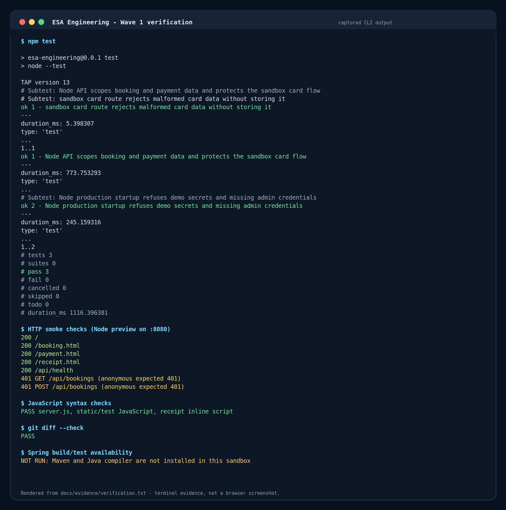

# ESA Engineering — Wave 1 implementation note

**Date:** 14 October 2026 · **Branch:** `arena/bb2fc367-esa`

## What changed

This wave focused on booking, enquiry and payment ownership/state checks in both the Node fallback and Spring Boot API. It also keeps the existing card option, but labels it as a demo/sandbox flow rather than a real payment service.

- Customer API requests now use the verified bearer-token email for identity. A booking form cannot assign its booking to a different email just by changing the request body.
- Portal reads/actions for bookings, payments and existing enquiries are limited to the signed-in account that owns the row. Guessed IDs belonging to someone else return not-found responses. Public contact-form submission remains open so visitors can send an enquiry; customer portal reads/actions are still scoped to the token email, while admin management is protected separately.
- Admin-only API operations, including creating another admin, require an admin session.
- Booking and payment state is checked before paying, cancelling or rescheduling. A logged bank transfer remains pending for staff verification; retrying the transfer action does not create another payment, and card payment is blocked while that transfer is pending.
- Card payment remains available in the UI as a **demo/sandbox** flow. It validates basic card fields and a Luhn checksum, marks a valid demo payment complete, and confirms the booking. It does not contact a payment gateway or move money. Only the last four digits are retained; the full card number and CVV are not saved.
- `paidDate`, payment method, transfer reference and card last-four data are persisted and included in customer/admin summaries. Existing transfer rows can still be displayed as transfers when their method field is empty.
- Receipt/payment pages use the saved payment details, show the transfer-pending state separately from paid, and send signed-out or expired customers back through sign-in.
- Production startup checks reject the demo token secret and sample first-admin credentials. Configure `JWT_SECRET`, `ADMIN_EMAIL` and `ADMIN_PASSWORD` for production; the local defaults are for development only.

## Payment state at a glance

| Action | Payment state | Booking state / next step |
| --- | --- | --- |
| New booking | `incomplete` | `pending`; customer can choose card demo or bank transfer |
| Bank transfer logged | `pending`, with method/reference/date | Not treated as paid; staff must check the bank and update it |
| Sandbox card approved | `completed`, with method, paid date and `cardLast4` | `confirmed`; no full card number or CVV is persisted |
| Repeat transfer request | Remains `pending` | Existing transfer is returned; it is not logged a second time |
| Card request after transfer | Rejected with `409` | Customer is told to contact the office |

## Representative code

### The signed-in account supplies the customer identity

`server.js` verifies the bearer token and puts its email on the request for customer routes:

```js
function requireCustomer(req, res, next) {
  const auth = req.headers.authorization;
  if (!auth) return res.status(401).json({ message: 'Sign in to view your portal', success: false });
  const payload = verifyToken(auth);
  if (!payload || !payload.email) return res.status(401).json({ message: 'Your session has expired - please sign in again', success: false });
  req.customerEmail = payload.email;
  next();
}
```

Booking creation uses that email instead of the submitted email (`server.js`, `/api/bookings`):

```js
app.post('/api/bookings', requireCustomer, (req, res) => {
  const { name, fullName, phone, service, serviceName } = req.body || {};
  const finalName = String(name || fullName || '').trim();
  const finalEmail = req.customerEmail;
  // validate the booking, then persist it for finalEmail
});
```

The Spring payment route applies the same ownership check before it returns or changes a payment (`ApiPublicController`):

```java
String email = portalAccess.requireCustomer(auth).getEmail();
Payment p = paymentRepo.findById(id)
        .orElseThrow(() -> ApiException.notFound("Payment not found"));
Booking booking = bookingForPayment(p, email);
```

`bookingForPayment` checks that the payment belongs to a booking owned by that account; the same helper is used by the Spring transfer and card actions.

### A transfer cannot be followed by a second card payment

The Node payment route is deliberately simple: pending transfer is a conflict for card payment, and a successful sandbox card stores only a last-four value.

```js
if (p.status === 'pending') {
  return res.status(409).json({ message: 'A bank transfer is already logged. Please contact us before paying by card.' });
}

p.status = 'completed';
p.method = 'card';
p.cardLast4 = number.slice(-4);
p.paidDate = new Date().toISOString().slice(0, 10);
```

The Spring card route mirrors the same pending-transfer check and `cardLast4` storage. Neither implementation stores the submitted full card number or CVV.

### Payment dates and methods are included in portal data

The Spring `Payment` model now has fields for `method`, `transferReference`, `paidDate` and `cardLast4`; the portal and admin mapping code exposes the relevant values. The receipt page prefers `paidDate` and falls back to its older `paymentDate` value when needed.

## Verification evidence



The image is a terminal-style evidence graphic rendered from the captured output in [`docs/evidence/verification.txt`](docs/evidence/verification.txt). It is **not a browser screenshot**; browser screenshot tooling was not available in this sandbox.

| Check | Result |
| --- | --- |
| `npm test` | **3 passed, 0 failed**. Covers Node ownership/payment flows and production-startup checks. |
| Node HTTP smoke checks | **200** for `/`, `/booking.html`, `/payment.html`, `/receipt.html` and `/api/health`; **401** for anonymous booking-list and booking-create requests. |
| JavaScript syntax | Passed for `server.js`, JavaScript under `static/` and `test/`, plus the inline receipt script. |
| `git diff --check` | Passed. |
| Java source syntax parser | Accepted 11 changed Java source/test files in an earlier check. This is only a syntax check. |
| Spring/Maven/JUnit | **Not run.** Maven and the Java compiler are not installed in this sandbox, so the Spring changes and added Java regression tests still need a real build/test run. |

## Scope and limits

- The card flow is only a project demo. Do not enter real card details or use this as a live checkout; a real payment provider and its server-side tokenisation/webhook flow are still a TODO.
- The Spring code has not been compiled or run under JUnit in this environment.
- This note documents the booking/payment security wave, not completion of the broader visual redesign or every remaining item in [`PAGE_AUDIT.md`](PAGE_AUDIT.md).
